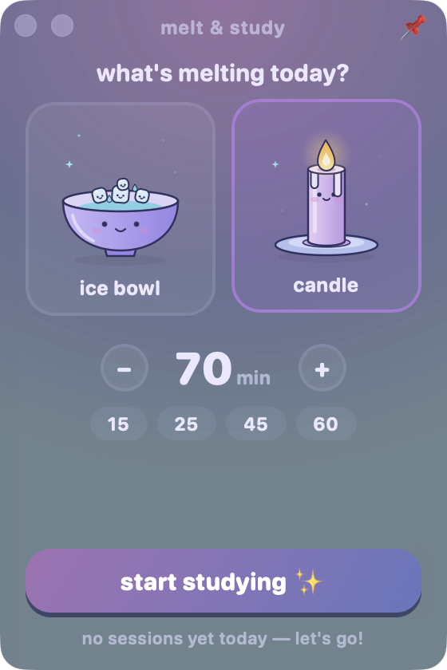

# melt & study 🧊🕯️

A tiny, cozy floating study timer for macOS. Pick a timer, then watch it melt while you study.



- **Ice bowl:** little ice cubes with faces melt into a smiling bowl, and the water rises as time passes.
- **Candle:** a candle burns down, drips wax and puffs out when you're done.

## Features
- Small frosted-glass window that floats above your other windows (📌 toggles this)
- 15 / 25 / 45 / 60 min presets, or set your own in 5-minute steps
- Pause and resume with the button or the spacebar
- Chime when the session ends
- Counts your sessions and minutes for the day
- Remembers a running session if you close the app
- Follows macOS light and dark mode

## Build & run
Needs macOS 12 or later and the Xcode command line tools (`xcode-select --install`).

```bash
./build.sh
open "Melt & Study.app"
```

## How it's made
- `src/index.html`: the whole UI and the SVG illustrations (HTML, CSS and JS)
- `src/main.swift`: a small native wrapper that shows the page in a floating, translucent window
- `src/make_icon.swift`: draws the app icon
- `build.sh`: compiles everything into `Melt & Study.app`
